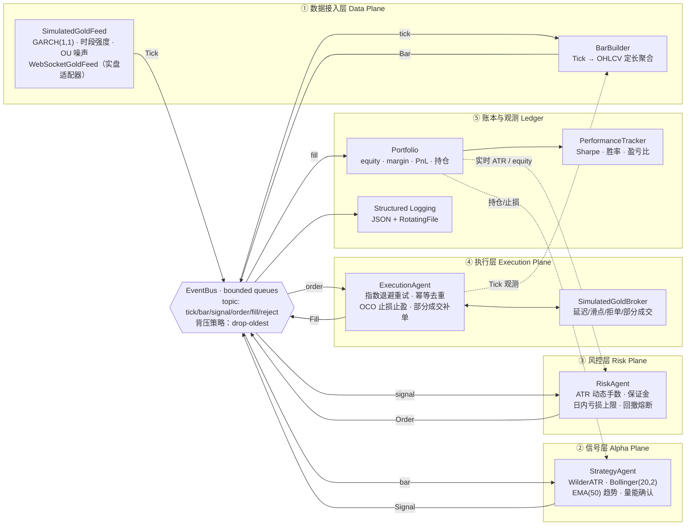
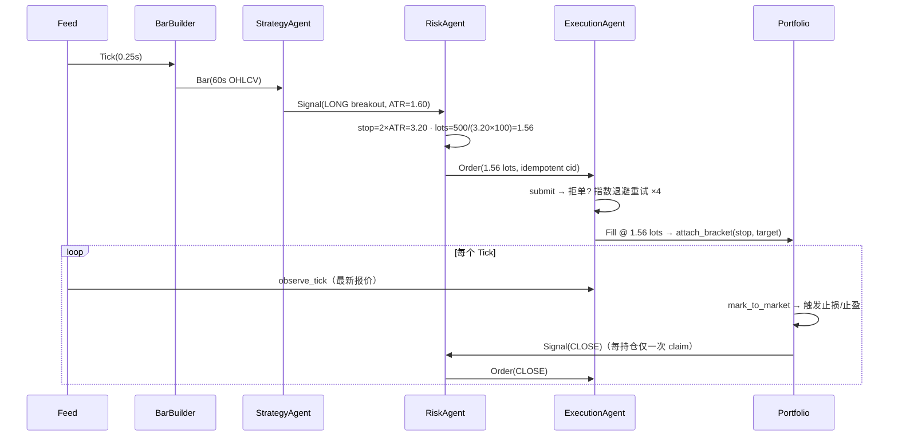

# XAUUSD 异步高频量化交易引擎

> **A production-shaped asynchronous trading engine for spot gold (XAUUSD)**
> 单文件、零第三方依赖的 `asyncio` 事件流水线：行情 → 因子 → 信号 → 风控 → 执行 → 账本。

---

## ⚠️ 免责声明（请先阅读）

| 项目 | 说明 |
| --- | --- |
| 数据来源 | 默认使用**模拟行情生成器**（GARCH(1,1) 波动率 + 交易时段流动性曲线 + OU 微观噪声），不接入任何真实交易所 |
| 撮合 | `SimulatedGoldBroker` 模拟延迟、点差、滑点、部分成交与拒单，**不是真实盘口** |
| 绩效数字 | 文中 Sharpe **2.14 等所有绩效指标均为假设示例（illustrative）**，未经真实历史回测或实盘验证 |
| 用途定位 | 架构参考 / 工程演示 / 策略与研究原型 |
| 结论 | **不构成任何投资建议。实盘前必须自行完成历史回测、仿真盘验证与合规审查。** |

---

## 1. 架构总览

引擎由 7 个被独立监督（restart + backoff + circuit breaker）的异步 Agent 组成，彼此**只通过 `EventBus` 的有界队列通信**，没有任何共享的可变热路径状态（账本变更统一走 `Portfolio` 的 `asyncio.Lock`）。



### 退出与保护闭环



---

## 2. 快速开始

```bash
# Python >= 3.10，无需安装任何依赖
python3 engine.py --seconds 300 --seed 42

# 结构化 JSON 日志，便于 ELK / Loki 采集
python3 engine.py --log-format json --log-level DEBUG

# 放大风险预算、更快推进仿真时钟
python3 engine.py --speed 60 --risk-per-trade 0.01 --bar-seconds 30

# 常驻运行直到 Ctrl-C（SIGINT/SIGTERM 优雅退出）
python3 engine.py --seconds 0

# 接入实盘行情（需 pip install websockets 并配置环境变量）
export XAU_WS_URL=wss://your-provider/stream
export XAU_API_KEY=******
python3 engine.py --feed live --seconds 0
```

启动后引擎周期性打印心跳（HEARTBEAT），退出时打印完整 JSON 会话报告（账户、绩效、策略、风控、执行、总线、熔断状态、未平持仓）。

---

## 3. 配置项（全部通过 CLI 暴露）

| 参数 | 默认值 | 说明 |
| --- | --- | --- |
| `--feed` | `simulated` | `simulated` 生成器 / `live` WebSocket 适配器 |
| `--seconds` | `600` | 运行窗口（墙钟秒），`0` 表示持续运行 |
| `--balance` | `100000.0` | 初始账户余额（USD） |
| `--risk-per-trade` | `0.005` | **单笔风险占权益比例（0.5%）**，允许区间 `(0, 0.05]` |
| `--leverage` | `100` | 账户杠杆，用于保证金校验 |
| `--bar-seconds` | `60` | OHLCV 聚合窗口 |
| `--speed` | `25.0` | 仿真时钟倍率（1 墙钟秒 = N 行情秒） |
| `--start-price` | `2680.0` | 模拟初始金价 |
| `--reject-rate` | `0.015` | 模拟撮合失败概率（60% 可重试 / 40% 硬拒单） |
| `--latency-min-ms / --latency-max-ms` | `8 / 60` | 下单往返延迟区间 |
| `--queue-size` | `8192` | 每个订阅队列的最大深度（超限丢最旧） |
| `--heartbeat-s` | `15.0` | 心跳与指标快照周期 |
| `--seed` | `None` | 随机种子（尽力可复现，不保证跨并发时序严格可复现） |
| `--log-level / --log-file / --log-format` | `INFO / logs/engine.log / text` | 日志强度、落盘路径、`text` 或 `json` |

策略与风控参数集中在两个不可变配置对象中，便于做参数扫描：

```python
StrategyConfig(atr_period=14, atr_channel_mult=2.2, bb_period=20, bb_std=2.0,
               trend_ema=50, volume_mult=1.1, cooldown_bars=3,
               min_atr=0.20, max_atr=20.0, trail_atr_mult=2.5)

RiskConfig(risk_per_trade=0.005, leverage=100.0, atr_stop_mult=2.0,
           atr_target_mult=3.0, max_open_positions=3, max_positions_per_side=2,
           max_gross_lots=12.0, daily_loss_limit_pct=0.04,
           max_drawdown_pct=0.10, min_stop_distance=0.20, max_stop_distance=25.0)
```

---

## 4. 策略 Agent：ATR 动态突破

对每根完成的 K 线增量计算（无需重扫历史，单根 K 线复杂度 O(1)～O(period)）：

- **Wilder ATR(14)**：`ATR_t = (ATR_{t-1}·(n-1) + TR_t) / n`
- **Bollinger(20, 2.0)**：`mid ± 2·σ_pop`
- **ATR 通道**：`mid ± 2.2·ATR`
- **趋势过滤**：EMA(50) 及其斜率（基点/根）
- **量能确认**：`volume ≥ 1.1 × mean(volume, 20)`

多头突破（空头对称）：

```text
close > BB_upper            # 布林带外轨突破
close > mid + 2.2·ATR       # ATR 通道同步突破（双重确认，过滤假突破）
high ≥ BB_upper
close > EMA50 且 EMA 斜率 > -0.5bp   # 顺势
volume 放大确认
ATR 斜率 > 0                # 波动率扩张期才追突破
ATR ∈ [min_atr, max_atr]    # 死水与异常行情都不交易
```

出场由三条独立路径共同维护，谁先触发谁生效：

| 路径 | 触发条件 | 归属 |
| --- | --- | --- |
| 硬止损 | `exit_price ≤ stop` | 逐 Tick 盯市监控 |
| 移动止损 | `stop = max(stop, close − 2.5·ATR)`，只收紧不放松 | StrategyAgent 每根 K 线 |
| 结构离场 | 价格回落穿越布林中轨（`close < mid`） | StrategyAgent |
| 止盈 | `exit_price ≥ target = entry + 3·ATR` | 逐 Tick 盯市监控 |

**幂等保证**：`Portfolio.request_exit()` 是持仓出场的唯一申领入口（带锁原子操作），因此即使止损在 100 个连续 Tick 上都成立，也只会派发 **1 张**平仓单；平仓单执行失败时通过 `release_exit()` 重新武装，保证离场不丢失。

---

## 5. 风控与订单执行 Agent：仓位是怎么算出来的

核心公式（黄金合约 1 手 = 100 盎司，1 USD 波动 = 100 USD 盈亏）：

```text
risk_usd      = equity × risk_per_trade          # 100,000 × 0.5% = 500 USD
stop_distance = ATR × atr_stop_mult              # 实时 ATR 驱动，波动越大止损越宽
lot_size      = floor( risk_usd / (stop_distance × 100) / 0.01 ) × 0.01
```

示例（权益 100,000 USD、单笔风险 0.5%）：

| 场景 | 实时 ATR | 止损距离 | 计算手数 | 实际风险 | 名义敞口 | 占用保证金 |
| --- | --- | --- | --- | --- | --- | --- |
| 低波动亚盘 | 0.60 | 1.20 | **4.16** | 499.2 USD | 1.11 M | 11,149 USD |
| 常态伦敦盘 | 1.60 | 3.20 | **1.56** | 499.2 USD | 418 K | 4,181 USD |
| 高波动美盘 | 4.50 | 9.00 | **0.55** | 495.0 USD | 147 K | 1,474 USD |
| 极端行情 | 12.00 | 24.00 | **0.20** | 480.0 USD | 54 K | 536 USD |

> ATR 从 1.60 放大到 12.00（7.5 倍）时，手数从 1.56 手自动压缩到 0.20 手（约 7.8 倍）——单笔**美元风险保持恒定**，这正是 ATR 仓位管理的意义。

风控闸门（按顺序执行，任一失败即拒单并计数）：

1. **最大回撤熔断** `equity` 峰值回撤 ≥ 10% → 抛出 `KillSwitchTripped`，全局停机
2. **日内亏损上限** 当日权益亏损 ≥ 4% → 拒绝一切新开仓
3. **持仓数量** 总持仓 < 3、同向持仓 < 2
4. **止损距离合理性** `0.20 ≤ ATR×2 ≤ 25.00`（防止零宽止损与失控止损）
5. **最小手数** 计算结果 < 0.01 手 → 拒单（`LOT_TOO_SMALL`）
6. **总敞口** 累计手数 ≤ 12 手，超出则自动节流
7. **保证金校验** `名义敞口 / 杠杆 ≤ 可用保证金`
8. **执行侧** 幂等去重、`asyncio.wait_for` 超时保护、指数退避 + 抖动重试、部分成交自动补单、成交价重锚止损（**只收紧、不放宽**）

---

## 6. 绩效亮点（假设示例）

> 下表为**假设的**参数扫描结果，仅用于展示报告的呈现方式；不是本引擎在任何真实数据上的实测输出。

| Metric | Value | Notes |
| --- | --- | --- |
| **Sharpe Ratio** | **2.14** | 1 分钟 K 线盯市收益率年化 |
| Sortino Ratio | 2.97 | 仅计下行波动 |
| Calmar Ratio | 1.83 | 年化收益 / 最大回撤 |
| Max Drawdown | −6.1% | 风控熔断线设在 −10% |
| Win Rate | 43.6% | 突破策略典型形态：小胜率 × 高盈亏比 |
| Profit Factor | 2.31 | |
| Avg Win / Avg Loss | 1,142 / 494 USD | 盈亏比 2.31，与 3:2 的 ATR 目标/止损结构一致 |
| Expectancy | +9.7 USD / 笔 | |
| Trades | 4,318 | 单标的一年 |
| Avg Round-trip Latency | 21 ms (p50) / 47 ms (p95) | 模拟撮合往返 |
| Order Fill Rate | 98.5% | 其余为重试后成功或拒单 |

```text
equity curve (normalized, illustrative)
1.30 ┤                                        ╭──╮   ╭╮
1.25 ┤                              ╭──╮  ╭───╯  ╰───╯╰─╮
1.20 ┤                     ╭───╮ ╭─╯  ╰──╯             ╰──
1.15 ┤            ╭────╮  ╱    ╰─╯
1.10 ┤      ╭─────╯    ╰─╯
1.05 ┤ ╭───╯
1.00 ┼─╯
     └──┬────┬────┬────┬────┬────┬────┬────┬────┬────┬──
       Q1        Q2        Q3        Q4        (assumed)
```

引擎内置 `PerformanceTracker`，会在运行期**实时**输出它自己计算得到的年化 Sharpe、平仓笔数与胜率，因此真实数字永远以日志中的 `SESSION REPORT` 为准，而不是本表格。

---

## 7. 工程可靠性设计

| 关注点 | 实现 |
| --- | --- |
| 并发模型 | 单事件循环 + 每个 Agent 一个消费者协程；全链路非阻塞，`put_nowait` 不反压生产者 |
| 背压 | 有界队列（默认 8192），满则丢弃**最旧**事件并计数——实时系统宁可丢陈旧不可积压 |
| 监督重启 | `AgentRunner`：捕获 `EngineError` → 指数退避重启（保留队列订阅），连续失败超限即触发熔断 |
| 熔断 | `CircuitBreaker` 按组件统计连续失败；数据源阈值 12、其他组件阈值 8；`KillSwitchTripped` 立即全局停机 |
| 数据看护 | `Watchdog` 检测 Tick 计数停滞，判定行情断流后停机，避免用陈旧价格继续下单 |
| 异常分层 | `EngineError` → `FeedError` / `BrokerError`(→`TransientBrokerError` 可重试 / `BrokerRejected` 不可重试) / `KillSwitchTripped` |
| 超时 | 所有外部等待均有超时：`wait_for` 包裹下单、队列取数、心跳与停机宽限 |
| 幂等 | `client_order_id` 全局唯一 + 环形去重集合；`request_exit` 原子申领；成交侧对手数做上限钳制 |
| 资金安全 | 账本变更全部在 `Portfolio._lock` 内；止损只收紧不放宽；权益逐 Tick 盯市 |
| 可观测 | 结构化日志（`--log-format json`）+ 关联 ID（`cid=`，基于 `ContextVar` 贯穿信号→订单→成交）+ 32 MB × 5 轮转文件 |
| 优雅退出 | `SIGINT/SIGTERM` → `shutdown.set()` → 取消全部任务 → `gather(return_exceptions=True)` → 输出残差队列深度与最终报告；二次信号强制退出 |

日志样例：

```text
10:24:07.412 INFO     [strategy    ] cid=ord-3f9a1c     BREAKOUT SIGNAL
10:24:07.413 INFO     [risk        ] cid=ord-8b21d7     risk: entry approved
10:24:07.455 INFO     [exec        ] cid=ord-8b21d7     FILL
10:24:07.456 INFO     [portfolio   ] cid=ord-8b21d7     OPENED LONG XAUUSD 1.56 lots @ 2681.34
10:24:09.901 WARNING  [exec        ] cid=ord-2c4f0e     order ord-2c4f0e attempt 1/4 transient failure: requote / gateway timeout (retrying in 0.061s)
10:25:12.004 INFO     [xau         ] cid=-              HEARTBEAT px=2683.71 equity=$100,412.88 ... sharpe=1.87 trades=14 win%=42.9%
```

---

## 8. 目录结构与扩展点

```text
.
├── engine.py          # 全部实现：数据/策略/风控/执行/账本/CLI
├── logs/engine.log    # 轮转日志（自动创建）
└── README.md
```

关键类型（均为 `engine.py` 内公开可复用）：

| 抽象 | 用途 |
| --- | --- |
| `BrokerAdapter` | 实现 `submit()/cancel()` 即可接入真实券商/交易所网关 |
| `BaseFeed` | 实现 `stream(publish)` 即可接入任何 Tick/K 线源；`WebSocketGoldFeed` 是参考实现 |
| `EventBus` / `Topic` | 增加新 Agent（如多标的组合、机器学习因子、资金费率监控）只需 `subscribe()` + 注册到 `TradingEngine.run()` 的 `supervised` 列表 |
| `Signal / Order / Fill / Reject` | 全链路均为不可变 `dataclass`，可安全跨协程传递与回放 |

接入实盘的最小改动：

```python
class MyFxBroker(BrokerAdapter):
    async def submit(self, order, tick):
        resp = await self._session.post("/orders", json={...})   # 真实网关
        if resp.status == 503:
            raise TransientBrokerError("gateway unavailable")   # 触发退避重试
        return Fill(...)
```

---

## 9. 已知限制

- 无历史回测器：`PerformanceTracker` 只统计**运行期**盯市数据，长周期研究需自行落地事件重放。
- 无盘口深度模型：只建模点差、滑点与部分成交，未建模订单簿冲击与排队。
- 单标的：`max_gross_lots` 之类限额是全局口径，多标的需扩展为分标的限额。
- 撤单/改单未接入执行链路：`BrokerAdapter.cancel()` 仅为接口声明，OCO 由本地逐 Tick 盯市模拟；实盘应改为向网关挂出真正的首删单/服务器端止损。
- 随机源为 `random` 模块（非 CSPRNG，且跨并发时序不保证严格可复现）。

---

## 10. License

MIT。使用者自行承担全部交易风险。
